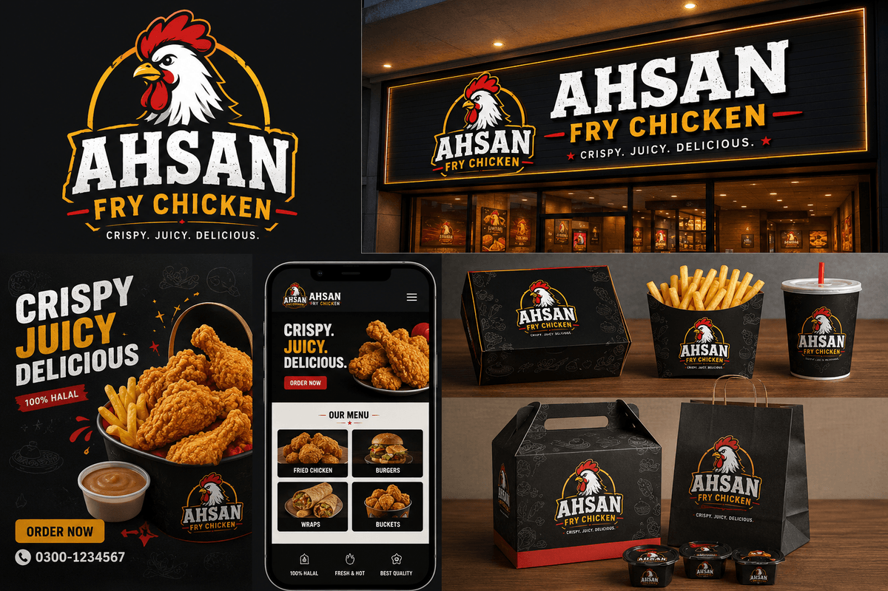

# Ahsan Fry Chicken — Premium Restaurant Website

A world-class, agency-quality single-page website for the premium fried-chicken brand **Ahsan Fry Chicken**. Cinematic hero video, luxury black-and-gold identity, and Framer Motion animation throughout.



## ✨ Highlights

- **Cinematic hero** — full-screen background video, animated split headline, floating food images with mouse parallax, rising spice particles, glass cards and a scroll indicator.
- **Luxury brand system** — custom SVG logo (gold / white / dark / mono variants), Deep Black + Luxury Gold + Warm Red palette, glassmorphism, gradient lighting and a subtle film-grain overlay.
- **13 fully-designed sections** — Navbar, Hero, Brand marquee, About (timeline + count-up stats), Signature Menu (filterable, tilt cards), Featured, Why Us, Gallery (masonry + lightbox), Testimonials (auto carousel), Promotions (live countdown), Reservation (UI form), FAQ (accordion), Contact (styled map) and Footer (newsletter).
- **Motion everywhere** — reveal-on-scroll, staggered groups, magnetic buttons, 3D tilt, count-ups, page-wide Lenis smooth scroll and a scroll-progress bar.

## 🧱 Tech Stack

| | |
|---|---|
| Framework | Next.js 15 (App Router) |
| Language | TypeScript |
| Styling | Tailwind CSS 3 |
| Animation | Framer Motion |
| Smooth scroll | Lenis |
| Icons | Lucide React |

## 🚀 Getting Started

```bash
npm install
npm run dev      # http://localhost:3000
npm run build    # production build
npm run start    # serve the production build
```

## 📁 Structure

```
public/
  video/hero.mp4            # cinematic hero video
  brand/                    # standalone logo SVGs (gold / white / mono)
  images/                   # menu, gallery, about, banner
src/
  app/                      # layout, page, globals, favicon (icon.svg)
  components/
    Logo.tsx                # multi-variant SVG logo
    SmoothScroll.tsx        # Lenis provider
    sections/               # every page section
    ui/                     # Button, Reveal, TiltCard, CountUp, Marquee, Magnetic…
  data/                     # menu + all content
  lib/utils.ts              # cn() helper
```

## 🎨 Brand

- **Fonts** — Bebas Neue (display), Sora (headings), Inter (body), loaded via `next/font`.
- **Colours** — `ink` (deep black), `gold`, `ember` (warm red), `cream`, `smoke`.
- **Logo** — `<Logo />` / `<LogoMark />` with `variant="gold | white | dark | mono"`.

## 🖼 Image Credits

Food photography sourced from [Unsplash](https://unsplash.com) (royalty-free). The hero video and banner were provided with the brief. All decorative graphics, patterns, textures and the logo are generated as inline SVG.

---

_Frontend-only project — no backend, database or APIs. All forms are UI-only._
